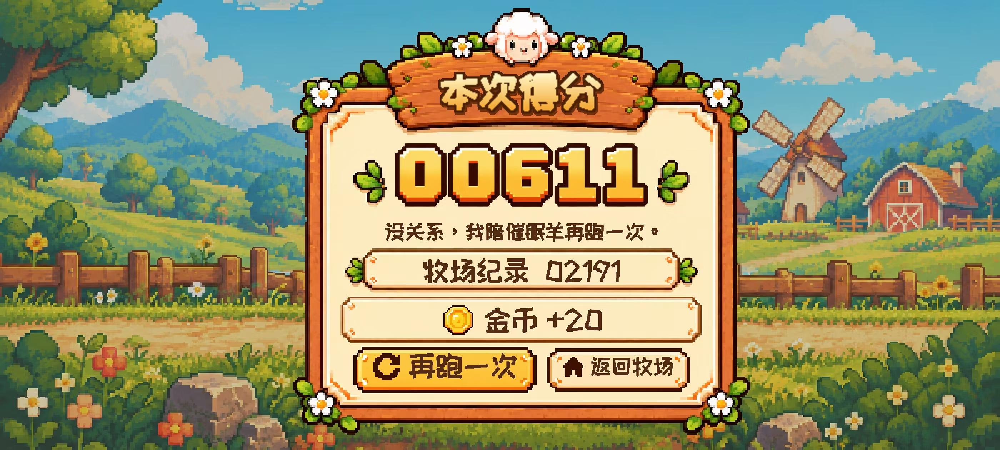

# 小羊快跑 · Sheep Run

一款面向手机横屏的像素牧场跑酷游戏。带着小羊越过障碍、收集星星，在四季更替的牧场里寻找徽章、明信片和写给你的信。

基于 **Phaser 4 + TypeScript + Vite**，同时提供 **Capacitor Android** 工程。


## 游戏内容

- **无尽跑酷**：轻点跳跃、上滑高跳、下滑蹲伏，躲开地面与空中障碍；随着奔跑逐渐提升速度。
- **星星与道具**：收集星星，使用磁铁、护盾和星星加倍道具，查看本局成绩与最高分。
- **四季牧场**：春夏秋冬场景、多层视差、昼夜变化和雨风效果，支持减少动态效果偏好。
- **小羊衣橱**：22 款皮肤，包括薄荷羊、催眠羊、梦境羊和小熊帽羊，可用游戏内星星或金币解锁。
- **四季收藏册**：寻找 12 枚季节徽章，阅读收集后的短笺与四季来信。
- **成就与风景手账**：记录旅程、发现彩虹等牧场风景，收藏明信片。
- **同行小羊与牧场动物**：旅途中偶遇同伴，背景中有独立活动的小动物。
- **小邮局与送信旅程**：阅读欢迎信和晚安信，体验「把晚安送到山坡上」的送信路线。
- **本地存档**：保存最高分、星星、金币、皮肤、收藏、成就和阅读记录。

跑道星星与暂停按钮下方的星星计数图标使用同款像素素材。未拾取的星星会继续向左滚动，整颗移出屏幕边缘后才消失；正常拾取仍立即生效。

## 界面预览

**加载画面**


**给催眠羊留的小饭桌**


**小羊衣橱**


**本局结算**



## 操作

| 操作 | 效果 |
| --- | --- |
| 轻点游戏区域 | 普通跳跃 |
| 向上滑动 | 高跳 |
| 向下滑动 | 短暂蹲伏 |
| 点击暂停按钮 | 暂停、继续或重新开始 |
| 点击菜单按钮 | 衣橱、收藏册、成就手账、邮箱与设置 |

当前版本以**触屏操作**为主，建议使用手机横屏游玩。电脑开发时可使用浏览器开发者工具的移动设备触摸模拟。Dash 功能默认关闭。

## 本地运行

### 环境

- Node.js 22（至少 22.12）或 Node.js 24，推荐使用 Node.js 24。
- npm；仓库也保留了 pnpm 锁文件。

```bash
git clone https://github.com/xibie111/sheep-run.git
cd sheep-run
npm ci
npm run dev
```

打开终端显示的地址，默认端口为 **4173**。手机与电脑连接同一个局域网时，可访问终端显示的 Network 地址；电脑需允许该端口通过防火墙。

端口被占用时：

```bash
npm run dev -- --port 4175
```

### 常用命令

| 命令 | 用途 |
| --- | --- |
| `npm run dev` | 启动开发服务器，默认端口 4173 |
| `npm run typecheck` | TypeScript 类型检查 |
| `npm test` | 运行 Vitest 测试 |
| `npm run build` | 类型检查并生成生产构建到 `dist/` |
| `npm run preview` | 预览生产构建，默认端口 4174 |

```bash
npm test
npm run build
npm run preview
```

构建后的 `dist/` 可部署到静态文件服务器。Vite 使用相对资源路径；开发与预览服务均绑定 `0.0.0.0`，方便局域网调试。

## Android 构建

仓库包含 Android 原生工程，应用名称为「小羊快跑」，应用 ID 为 `com.sheeprun.game`，当前版本为 **1.0.1**。

构建环境：

- 完整的 JDK 21，包括 `javac` 与 `jlink`。
- Android SDK Platform 36、Build Tools 36.0.0，并配置 SDK 路径。
- Android 最低 API 24；目标 API 36。

先构建网页并同步 Capacitor，再生成调试 APK。以下示例使用 Windows PowerShell：

```powershell
npm ci
npm run build
npx cap sync android
Push-Location android
.\gradlew.bat assembleDebug
Pop-Location
```

APK 输出位置：`android/app/build/outputs/apk/debug/app-debug.apk`。

也可以执行 `npx cap open android`，在 Android Studio 中构建和调试。仓库不包含本机 SDK、下载的 JDK、签名密钥或已有 APK；调试 APK 与正式签名发布包应分别管理。

## 项目结构

```text
src/
  game/         游戏配置、视口、常量与障碍定义
  scenes/       加载、菜单、跑酷、暂停、衣橱与结算场景
  systems/      手势、碰撞、计分、存档、道具与成长系统
  data/         皮肤目录、素材索引、信件与文案
  ui/           触屏按钮、收藏册、手账、邮箱与像素文字
  environment/  四季、天气、昼夜与视差背景
  companions/   同行小羊
  ambient/      牧场动物与环境活动
  scenery/      风景发现与明信片
  delivery/     送信路线与相关界面
assets/         游戏图片、动画、音频与字体
android/        Capacitor Android 工程
legacy/         早期 Canvas 版本，供参考
tools/         素材处理、字体生成与验收脚本
docs/images/    README 预览图
```

`legacy/` 不由当前游戏加载，也不进入生产构建。部分 `tools/` 浏览器验收脚本使用原开发机上的 Playwright 路径，换机运行前需调整依赖路径；日常启动、测试与构建使用上面的 npm 命令。

## 显示与存档

游戏以 **480 × 270** 为基准，统一比例缩放并保持像素风格：宽屏展示更多道路，较高的屏幕展示更多天空和地面。Android 客户端同时处理全屏与系统安全区域。

进度保存在浏览器或 Android WebView 的本地存储中，不提供账号登录和云同步。更换设备、切换网站地址或清除应用数据后，存档不会自动迁移。存储不可用时，部分功能会保留当前会话并提示保存状态。

## 素材与许可

游戏素材位于 `assets/`，多个素材目录保留了生成记录、提示词或打包清单。像素字体的来源说明与第三方许可证见 [`assets/fonts/README.md`](assets/fonts/README.md) 及同目录的 OFL 文件。

仓库暂未添加项目级 `LICENSE`。历史验收资料、重复构建快照、依赖和本机工具链保留在开发机，不随源码上传。

`CHANGELOG.md` 是早期迁移阶段的草稿；当前功能与运行方式以本 README 和源码为准。
